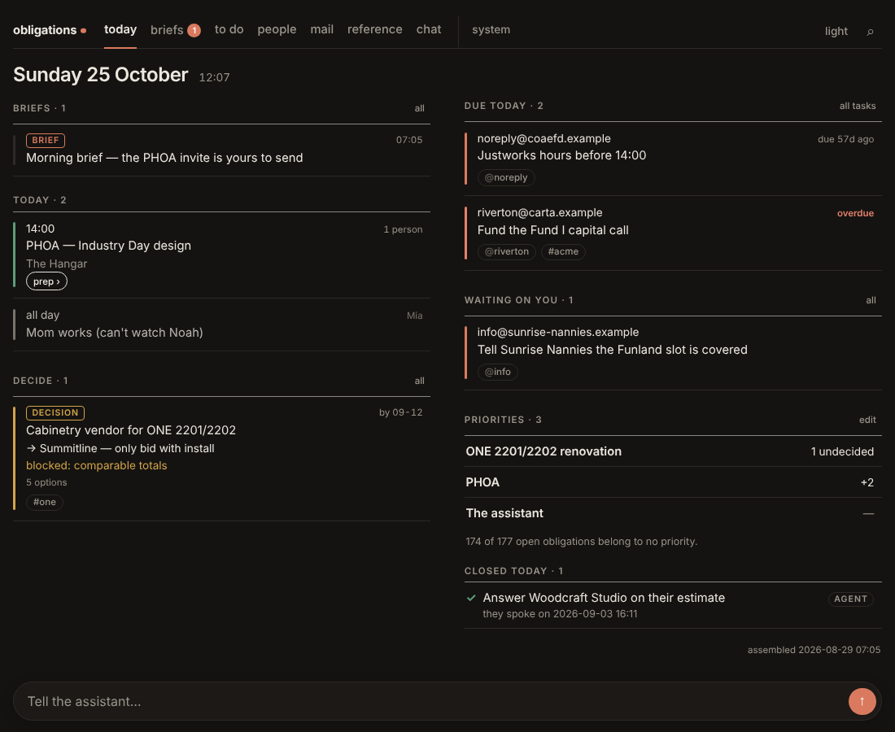
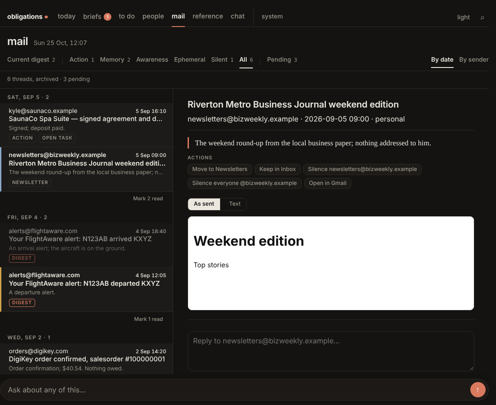
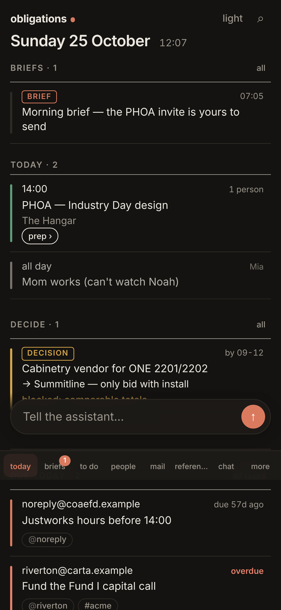

<div align="center">

# Obligations

**A chief of staff that lives on your Mac.**

It reads your mail, texts and calendar, works out what you owe and what you
are owed, keeps one task list across all of it, drafts the replies, chases
what has gone quiet, and sends you one morning brief a day.


[**Install**](docs/INSTALL.md) · [What it does](#what-it-does) · [Built for the Mac](#built-for-the-mac) · [The web UI](#the-web-ui) · [Design](#design)

<br>



</div>

<br>

> [!NOTE]
> **Obligations is built for a Mac that stays on**, such as a Mac mini on a
> shelf. Your texts, calls, Contacts and Reminders only exist on a Mac, and
> two native apps run it there. A Linux box can run the mail, calendar and
> brief side without texts. See [Linux, without texts](#linux-without-texts).

Everything it knows lives in this repo as plain markdown and JSON, versioned in
git. It was extracted from a system one person ran for months on their own
mail. The prompts, rules and tests are written about an example owner,
**Alex Rivera**, and every person, company and number in them is fictional.

## What it does

<table>
<tr>
<td width="50%" valign="top">

**One task list, not five.**
Mail, texts, reminders, recurring obligations and a hand-kept `todo.md` merge
into one list. Each obligation has a four-character code and one record of its
state.

</td>
<td width="50%" valign="top">

**Triage that closes things.**
A mail job and a message job judge what came in. They open obligations for
what you owe and close them when the evidence shows they are done: a receipt,
a reply, the other side answering.

</td>
</tr>
<tr>
<td valign="top">

**Drafts, never sends.**
Replies and chases are drafted for you, and your tap sends them. Scheduled jobs
cannot send, delete or create mail filters.

</td>
<td valign="top">

**One brief a day.**
At 07:00, written to be read on a phone in ninety seconds. It leads with what
the assistant changed on your behalf.

</td>
</tr>
<tr>
<td valign="top">

**Chases what has gone quiet.**
Something someone owes you that has been quiet for five days gets one drafted
follow-up a week per person. The chase is held while you owe them something
yourself.

</td>
<td valign="top">

**Meeting prep and debriefs.**
A prep note an hour before each meeting, and a debrief afterwards that turns
what you said you would do into obligations.

</td>
</tr>
</table>

## Built for the Mac

On a Mac the system is two apps that split the work along a privacy line:

| | What it holds | What it does |
|---|---|---|
| **Obligations.app**<br><sub>`deploy/mac-app`</sub> | The privacy grants: Full Disk Access, Contacts, Reminders, Messages | Lives in the menu bar. Runs the iMessage, call and Contacts extractors, sends the texts you approve, and manages the Google accounts. **Never runs code from the repo.** |
| **Obligations Server.app**<br><sub>`deploy/mac-server`</sub> | No grants at all | Runs the service and the minute dispatcher inside a macOS sandbox profile: no reads under your home except the repo, no Apple Events, one listening port. |

The two share data files in the repo and nothing else, so the code the
assistant can edit never runs with access to your messages.

**Obligations for iPhone, iPad and Mac** (`deploy/ios-app`) wraps the web UI in
a native shell and adds real push notifications (APNs) and location reports.

All three ship with placeholder identifiers (`com.example.obligations.*`, team
`ABCDE12345`, host `obligations.example.com`), which you replace when you build.

## The web UI

The server serves one web app on one port, for your browser, your phone, or
the apps. It is designed phone-first.

<table>
<tr>
<td width="68%" valign="top"></td>
<td width="32%" valign="top"></td>
</tr>
</table>

| Page | What it's for |
|---|---|
| **Today** `/` | Meetings with prep, decisions, what's due, priorities, what closed, what the assistant said to you |
| **To Do** `/todo` | Everything you owe, in today's ranked order. Work through it one task at a time, by lane (reply, decide, pay, call, admin) or by project, or as a map |
| **People** `/people` | The people you deal with, from mail, texts and Contacts |
| **Mail** `/mail` | The current digest, then everything judged, by tier |
| **Briefs** `/briefs` | Every message the assistant sent you, briefs included |
| **Chat** `/chat` | The same assistant as the jobs, with the same rules and files |

## Installing

**[docs/INSTALL.md](docs/INSTALL.md)** walks through the whole install, from a
private copy to the first morning brief. Allow an afternoon.

The short version, on a Mac:

```bash
# 1. Your own copy. Make it private: it will hold your mail conclusions and contacts
git clone https://github.com/marcusadolfsson/obligations.git ~/Developer/obligations
cd ~/Developer/obligations

# 2. Tools
xcode-select --install
brew install node@22 python@3.12 xcodegen
npm ci --prefix deploy/agent-service

# 3. Configure
cp deploy/.env.example deploy/.env        # set OWNER_NAME
node deploy/integrations/google-auth-cli.mjs --account=personal --enable=mail,calendar,drive

# 4. Build both apps, then turn the server on from the menu bar
./deploy/mac-app/build.sh
./deploy/mac-server/build.sh

# 5. Check
./deploy/test.sh                          # must end ALL PASSED
```

The rules in `CLAUDE.md` assume the owner is called Alex and use "he". Edit
them to fit. The code reads the name from `OWNER_NAME`.

### Linux, without texts

Mail, calendar, the task list, the brief, drafts and the web UI run the same on
a Linux box with Docker and systemd
(`OBLIGATIONS=~/obligations ./deploy/install-systemd.sh`). Texts, calls,
Contacts and Reminders need the Mac.

## Layout

| Path | What |
|---|---|
| `CLAUDE.md` | Operating rules for the assistant. Read this first. |
| `deploy/CLAUDE.md` | Rules for developing it: guards, test gate, working order. |
| `deploy/PIPELINE.md` | The map: which script does what and what gates each model call. |
| `jobs/` | The scheduled jobs' prompts (morning brief, evening, mail, messages). |
| `rules/` | Policies: email triage, reminders, messages, capabilities, verdicts. |
| `.claude/skills/` | The triage skills the jobs run. |
| `deploy/agent-service/` | The server: web UI, API, scheduler, model gate. |
| `deploy/integrations/` | Extractors for Gmail, Calendar, Drive, iMessage, Contacts. |
| `deploy/mac-app/`, `deploy/mac-server/`, `deploy/ios-app/` | The apps. |
| `now.md`, `todo.md`, `reminders.md`, `recurring.md`, `decisions.md`, `logbook.md` | Your state, empty to start. |
| `journal/`, `people/`, `projects/`, `messages/`, `outbox/`, `inbox/`, `reference/` | Your memory, empty to start. |

## Design

**Hot/cold split.** `now.md` and `todo.md` load every session. Everything else
is grepped on demand.

**The journal is authoritative; everything else is cache.** `journal/` is
append-only. `people/` and `projects/` are derived from it by the weekly
compaction, so if they drift, they can be rebuilt.

**Git is the undo button.** Every write is committed. A bad autonomous run at
3am is `git revert`, not a lost memory.

**A silence must never look like a success.** A source that could not be read
is named under *blind*. Every held chase and every change the assistant made
is named in the next brief.

The reasoning behind the rules is in `docs/why.md`.

## License

MIT. See [`LICENSE`](LICENSE).
